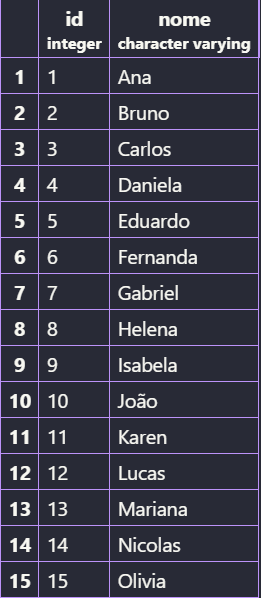

## Biblioteca

### Criação das tabelas
```sql
CREATE TABLE alunos (
    id SERIAL PRIMARY KEY,
    nome VARCHAR(100) NOT NULL
);

CREATE TABLE emprestimos (
    id SERIAL PRIMARY KEY,
    livro VARCHAR(100) NOT NULL,
    id_aluno INT,
    FOREIGN KEY (id_aluno) REFERENCES alunos(id)
);
```
### Inserindo dados as tabelas
```sql
INSERT INTO alunos (nome) VALUES
('Ana'),
('Bruno'),
('Carlos'),
('Daniela'),
('Eduardo'),
('Fernanda'),
('Gabriel'),
('Helena'),
('Isabela'),
('João'),
('Karen'),
('Lucas'),
('Mariana'),
('Nicolas'),
('Olivia');

INSERT INTO emprestimos (livro, id_aluno) VALUES
('Harry Potter', 1),
('O Pequeno Príncipe', 2),
('Turma da Mônica', 3),
('Dom Casmurro', 4),
('O Menino Maluquinho', 5),
('Percy Jackson', 6),
('Diário de um Banana', 7),
('As Crônicas de Nárnia', 8),
('Peter Pan', 9),
('Alice no País das Maravilhas', 10);
```
---
###  Tabelas finais 
```sql
SELECT * FROM alunos;
```

---
```sql
SELECT * FROM emprestimos;
```

---
```sql
SELECT 
    alunos.nome,
    emprestimos.livro
FROM alunos
INNER JOIN emprestimos
ON alunos.id = emprestimos.id_aluno;
```

---
```sql
SELECT 
    alunos.nome
FROM alunos
LEFT JOIN emprestimos
ON alunos.id = emprestimos.id_aluno
WHERE emprestimos.id IS NULL;
```

---
```sql
SELECT 
    alunos.nome,
    emprestimos.livro
FROM alunos
LEFT JOIN emprestimos
ON alunos.id = emprestimos.id_aluno;
```

